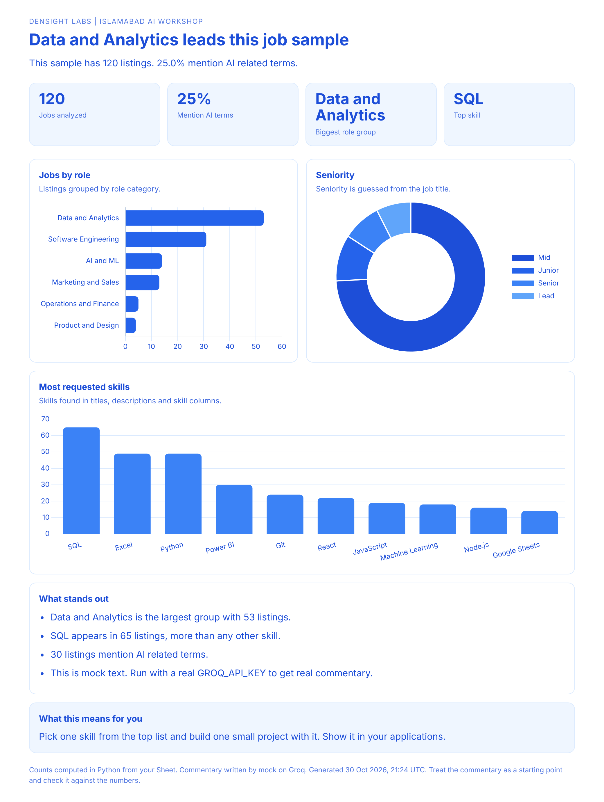
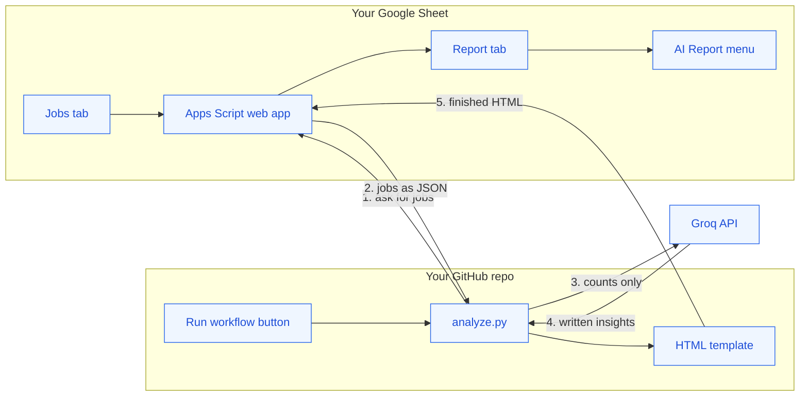
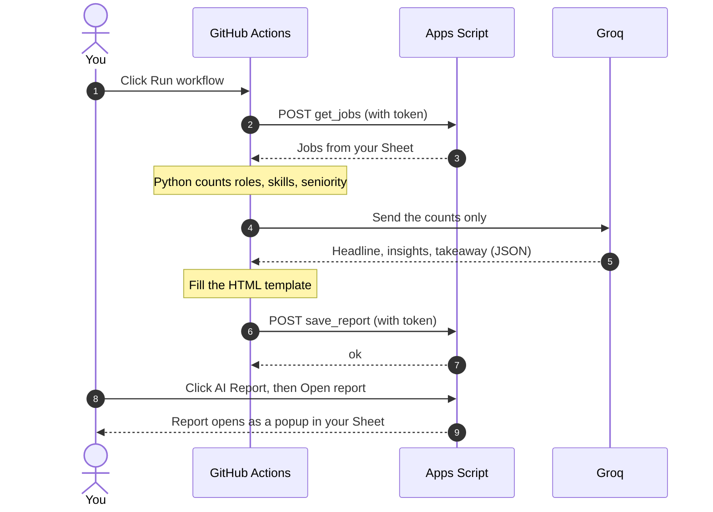
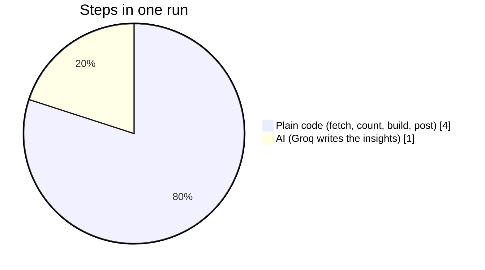
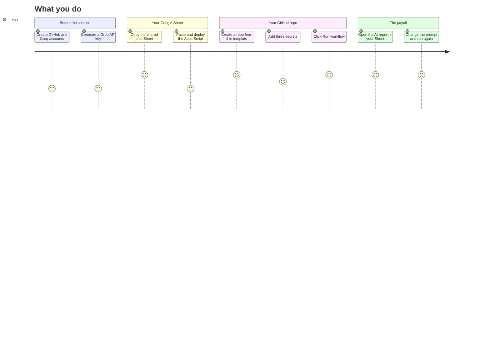

<div align="center">

# Build a workflow agent with GitHub

### Islamabad AI Workshop | Densight Labs

Turn a Google Sheet of job listings into an AI written HTML report, using nothing but GitHub Actions, the free Groq API and Google Apps Script.


[**Use this template**](https://github.com/numanahmadhere/islamabad_oct26_workshop/generate) | [Attendee guide](guide/ATTENDEE_GUIDE.md) | [Example report](guide/example_report.html)

</div>

---

## What you will build

A chatbot waits for you to type. A **workflow agent** does not wait. It wakes up on a trigger, does several steps on its own, and leaves a finished result somewhere you can see it.

In this workshop your agent will:

1. Read job listings from **your own copy of a Google Sheet**
2. Count roles, skills and seniority with **plain Python**
3. Ask **Groq** to write the insights from those counts
4. Fill a designed **HTML report**
5. Send it back to your Sheet, where it opens as a popup from a menu



*The report your agent produces. This preview was built from the synthetic sample data in this repo.*

---

## How it fits together

Three systems, one web address connecting your Sheet and GitHub. No Google API keys, no servers.



### One run, step by step



### Where the AI is, and where it is not

An agent is mostly reliable plumbing with one thinking step in the middle. Code does what code does best: exact, repeatable, free. The model does what code cannot: read numbers and explain them in plain language.



| Step | Who does it | Why |
|---|---|---|
| Fetch jobs from the Sheet | Code | Exact, no judgement needed |
| Count roles, skills, seniority | Code | Counting is something models get wrong |
| Write the insights | **Groq** | Turning numbers into sentences is a language task |
| Fill the template | Code | Same layout every run, so the report never breaks |
| Save to the Sheet | Code | Plain data transfer |

Groq never sees the raw job postings, only the totals. That keeps each call small, fast and inside the free tier.

---

## Your path through the workshop



The full click by click version, with the exact secret names and fixes for common errors, is in the **[Attendee guide](guide/ATTENDEE_GUIDE.md)**.

---

## Quick start

### 1. Create your repo from this template

Click **Use this template** at the top of this page, then **Create a new repository**. Name it anything you like.

### 2. Set up your Sheet

1. Open the shared jobs Sheet and choose **File > Make a copy**.
2. Make sure the data tab is named **Jobs** and row 1 holds the column names.
3. Open **Extensions > Apps Script**, paste in [`apps_script/Code.gs`](apps_script/Code.gs), and change `SECRET_TOKEN` to the word shared in the room.
4. **Deploy > New deployment > Web app**. Set *Execute as* to **Me** and *Who has access* to **Anyone**. Approve the authorization screen and copy the web app URL.

### 3. Add three secrets to your repo

In your repo: **Settings > Secrets and variables > Actions > New repository secret**.

| Secret name | Value |
|---|---|
| `GROQ_API_KEY` | Your key from [console.groq.com](https://console.groq.com) |
| `APPS_SCRIPT_URL` | The web app URL ending in `/exec` |
| `SECRET_TOKEN` | The same word you put in `Code.gs` |

The names must match exactly.

### 4. Run it

Open the **Actions** tab, choose **Analyze jobs**, click **Run workflow**. When the run turns green, go to your Sheet, refresh, and choose **AI Report > Open report**.

---

## Your Sheet columns

The script looks for these column names and ignores the rest. Only a title column is required.

| Column | Accepted names | Used for |
|---|---|---|
| Title | `title`, `job_title`, `position`, `role` | Role group and seniority |
| Description | `description`, `details`, `summary` | Skills and AI mentions |
| Skills | `skills`, `tags`, `requirements` | Skill counts |
| Location | `location`, `city` | Top locations |
| Company | `company`, `employer` | Top companies |
| Seniority | `seniority`, `level` | Overrides the guess from the title |

---

## Make it yours

Everything worth changing is in `scripts/analyze.py` and is commented for beginners.

| Want to change | Where |
|---|---|
| What the AI writes about | `SYSTEM_PROMPT` in `analyze.py` |
| Role groups | `ROLE_RULES` in `analyze.py` |
| Skills it looks for | `SKILLS` in `analyze.py` |
| Colors and layout of the report | `scripts/report_template.html` |
| The AI model | The **model** box when you click Run workflow |
| Run it automatically every week | Uncomment the `schedule` lines in `.github/workflows/analyze-jobs.yml` |

Stuck? Paste the file into Claude or ChatGPT, describe the change you want, and ask for the edited version.

---

## What is in this repo

```
.
├── .github/workflows/analyze-jobs.yml   The workflow (trigger, setup, run)
├── scripts/
│   ├── analyze.py                       The agent: fetch, count, think, build, post
│   └── report_template.html             The report design
├── apps_script/Code.gs                  Paste this into your Sheet
├── sample_data/jobs_sample.csv          Synthetic listings for testing
├── guide/
│   ├── ATTENDEE_GUIDE.md                Step by step, with fixes
│   └── example_report.html              Fallback report to show if wifi fails
├── docs/report-preview.png              The picture above
└── requirements.txt
```

### Try it without any keys

You can test the whole pipeline on your laptop with the sample data and a fake AI reply:

```bash
pip install -r requirements.txt
MOCK_GROQ=1 SKIP_POST=1 JOBS_CSV=sample_data/jobs_sample.csv python scripts/analyze.py
```

Then open `out/report.html` in a browser. The sample file is **synthetic**, written for the workshop, and does not describe the real job market.

---

## Fix it fast

| What you see | Likely cause | Fix |
|---|---|---|
| `Missing setting GROQ_API_KEY` | Secret name typo | Re-add it with the exact name |
| `Bad token` | Token differs between `Code.gs` and the secret | Make them identical, then redeploy the script |
| `The web app did not return JSON` | Deployment not set to Anyone, or wrong URL | Redeploy as Anyone and copy the URL ending in `/exec` |
| `No tab named "Jobs"` | Data tab has another name | Rename the tab to `Jobs` |
| Groq `401` | Key has a typo or a space | Generate and paste a fresh key |
| Groq says the model is not recognised | Model name has changed | Pick a current model at console.groq.com and type it in the Run workflow box |
| Groq `429` | Free tier rate limit | The script waits and retries. If it still fails, wait a minute and run again |
| Menu says no report yet | Workflow has not finished, or you did not refresh | Wait for the green tick, then refresh the Sheet |
| Edited `Code.gs` but nothing changed | Old deployment still live | **Deploy > Manage deployments > Edit > New version** |

---

## Good habits this repo teaches

- **Secrets stay in secrets.** Keys live in repo settings, never in code.
- **Send the model as little as possible.** Totals, not raw data. It is cheaper, faster and more private.
- **Make the AI fill a template.** A fixed layout means the output never breaks.
- **Treat AI commentary as a draft.** Check every sentence against the numbers.
- **Keep a human in the loop.** This agent writes a report for you to read. Anything that sends or publishes should wait for your approval.

---

<div align="center">

Built for the Islamabad AI Workshop by **[Densight Labs](https://densightlabs.com)**

</div>
